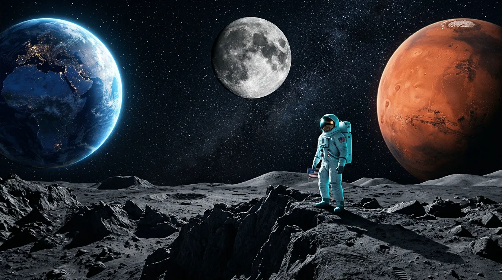
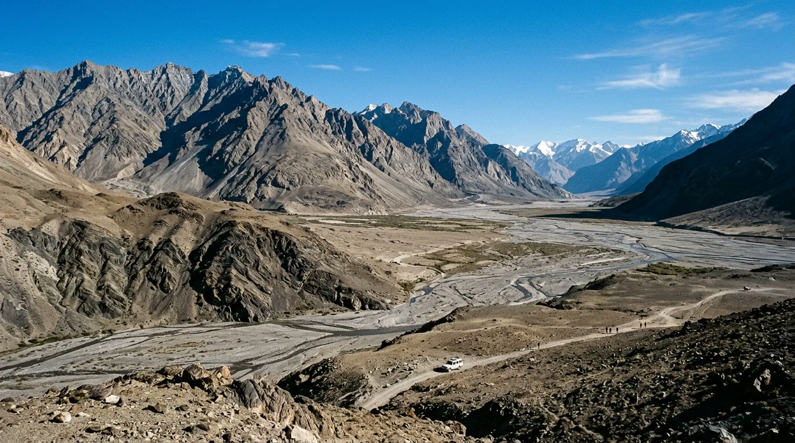
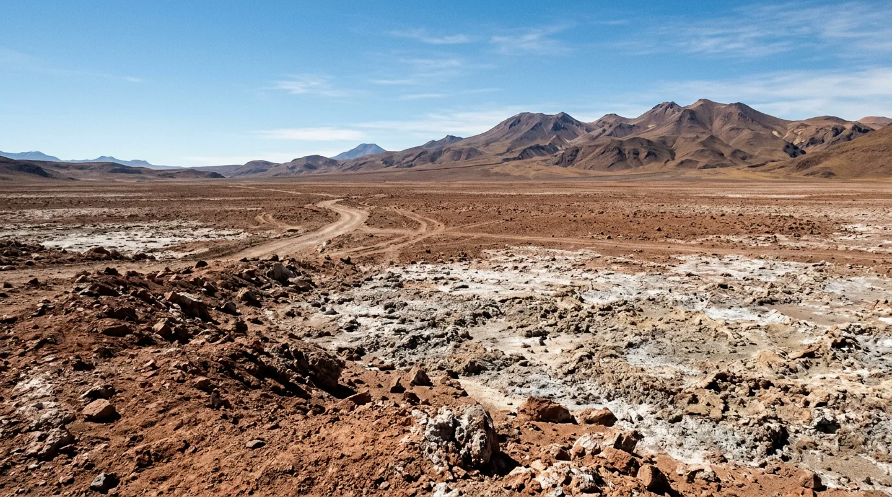
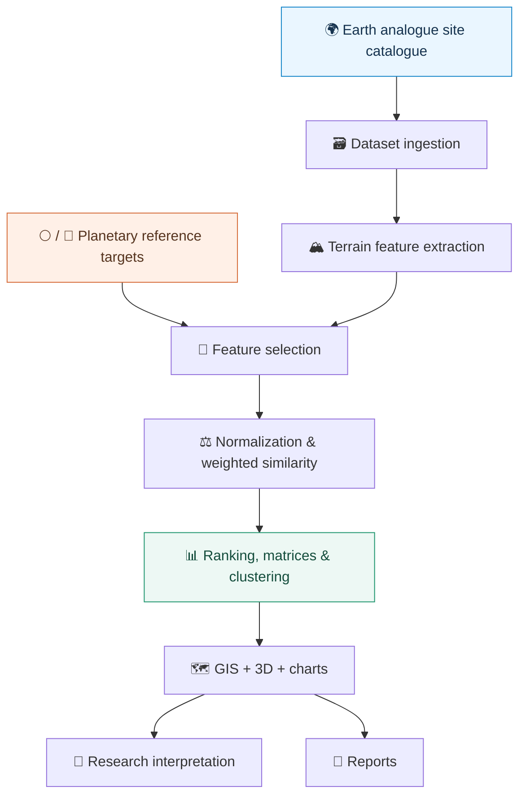
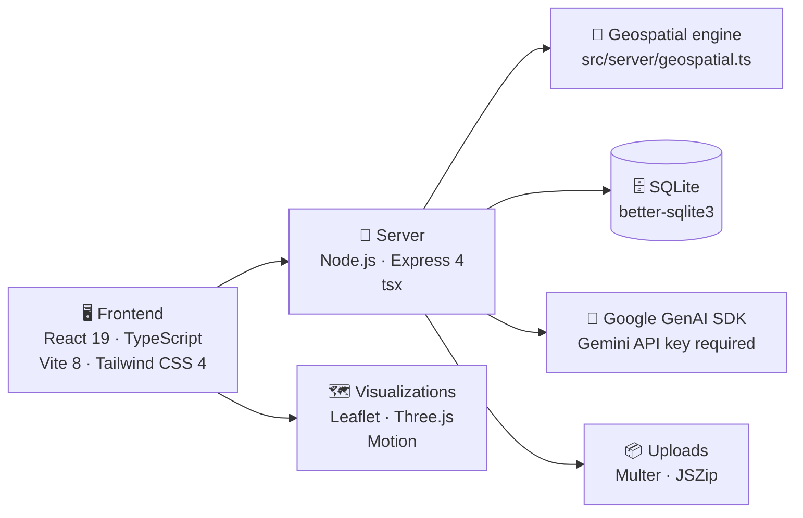

<div align="center">

# 🌍 VISION ASTRAA 🚀
### Earth · Moon · Mars — Terrain Intelligence & Terrestrial Analogue Discovery

**From Earth's extreme landscapes to the next frontier of planetary exploration.**

[](https://react.dev/)
[](https://www.typescriptlang.org/)
[](https://vite.dev/)
[](https://threejs.org/)
[](https://expressjs.com/)
[](https://sqlite.org/)
[](https://www.spaceappschallenge.org/)

**[Explore Features](#-platform-capabilities) · [How It Works](#-scientific-workflow) · [Tech Stack](#-technology-stack) · [Run Locally](#-quick-start) · [API](#-backend-api)**

</div>

---

## Cinematic field guide

The root page opens a nine-chapter story on Earth, the Moon, and Mars. Chapter navigation leads to the paired terrain charts, analogue finder, interactive 3D viewer, data center, research copilot and report export. The original tools are available from the research chapter as an in-page workstation when the Express backend is running.

Install and verify with Node.js 24.

```sh
npm ci
npm run typecheck
npm run build
NODE_ENV=production npm start
```

Use `npm run dev` for local development. The Express service serves both the cinematic experience and the existing APIs. Persist the `data/` directory on the host to keep SQLite reports and uploaded datasets between restarts. Set `GEMINI_API_KEY` in the server environment to enable Gemini. The data-grounded local copilot is available without a key. The standalone static build serves terrain comparison and export without the persistent APIs.

The original benchmark catalog and algorithms are retained. The new terrain meshes and derived terrain measurements come from real, independently sourced regional DEM windows centered on the fifteen original sites. `public/data/provenance.json` records source products, resolution and datum. The original weighted score and cluster results are displayed as research reference output. Synthetic calibration data remain explicitly identified.

The story uses excerpts of the supplied Earth and lunar opening, the supplied Jezero flyover, and the supplied planetary sequence. The Earth laboratory uses [NASA's Grand Canyon photograph from the ISS](https://images.nasa.gov/details/iss074e0208838) because the uploads lacked a dedicated terrestrial landscape video. The clips are labeled as cinematic visualizations.

## ✨ The Vision

> **Can we use Earth's extreme terrains to better understand environments on the Moon and Mars?**

**VISION ASTRAA** is a geospatial research prototype that brings terrestrial analogue sites, planetary reference targets, terrain metrics, interactive maps, 3D visualization, similarity analysis, and AI-assisted interpretation into a single interface.

Rather than treating an Earth location as a perfect planetary match, the platform supports **evidence-based comparison** and helps researchers explore *which properties* are similar, *which differ*, and *which data are missing*.

### 🎯 Problem → Solution

| The challenge | Our approach |
|---|---|
| Planetary terrain data are distributed across sources | One research workspace for catalogues, datasets and results |
| Terrestrial analogues are difficult to explore geographically | Interactive GIS site explorer and site profiles |
| Comparing terrain requires several quantitative measurements | Configurable feature-based similarity analysis |
| Elevation data are hard to interpret in raw form | 3D terrain meshes and scientific charts |
| Results need context and caveats | Research assistant, provenance and report workflows |

## 🖼️ Project visuals

<div align="center">
  
  <br/>
  <sub>Project visual asset — illustrative artwork, not a live NASA observation.</sub>
</div>

<table>
<tr>
<td width="50%"></td>
<td width="50%"></td>
</tr>
<tr><td align="center"><b>Ladakh terrain</b></td><td align="center"><b>Atacama desert analogue</b></td></tr>
</table>

> **Image note:** These are repository visual assets. Their acquisition sources and licenses should be checked before describing them as scientific satellite observations or using them externally.

---

## 🛰️ Platform capabilities

| Module | Purpose | Implementation entry point |
|---|---|---|
| 🏠 **Landing** | Cinematic introduction and research navigation | `src/views/LandingView.tsx` |
| 📊 **Mission Dashboard** | Overview of sites, datasets and analysis | `src/views/DashboardView.tsx` |
| 🌐 **Planetary Explorer** | Planetary 3D views and site exploration | `src/views/ExplorerView.tsx` |
| 📍 **GIS Explorer** | Geographic site markers and map inspection | `src/components/LeafletMapExplorer.tsx` |
| 🧭 **Analogue Finder** | Candidate ranking and configurable weights | `src/views/AnalogFinderView.tsx` |
| ⚖️ **Comparison Studio** | Compare sites and terrain characteristics | `src/views/ComparisonView.tsx` |
| 🏔️ **Terrain 3D** | Elevation mesh visualization | `src/components/TerrainMesh3D.tsx` |
| 📈 **Visualization Lab** | Morphometric charts and clustering views | `src/views/VisualizationLabView.tsx` |
| 🗃️ **Data Center** | Dataset inspection, upload and management | `src/views/DataCenterView.tsx` |
| 🤖 **Research Assistant** | Gemini-powered research support when configured | `src/views/AssistantView.tsx` |
| 📝 **Reports** | Store and manage research reports | `src/views/ReportsView.tsx` |

**Implementation note:** These modules and corresponding source files are present in the uploaded repository. This table is a source-code inventory, **not** a claim that every workflow has been fully tested or scientifically validated.

---

## 🔬 Scientific workflow



### Step-by-step research journey

1. **Choose a planetary reference** — select a supported lunar or Martian target.
2. **Explore terrestrial analogues** — inspect site geography and environmental metadata.
3. **Load data** — ingest supported scientific files and check their provenance.
4. **Extract terrain features** — use geospatial processing to derive measurable properties.
5. **Evaluate similarity** — configure feature weights and compare available metrics.
6. **Inspect results** — explore rankings, scientific plots, maps and 3D terrain.
7. **Document findings** — save a research report and record limitations.

### 🧪 Scientific integrity

- **Real observations, catalogue references, and synthetic demonstrations are different categories.** Keep them labeled.
- The repository includes **synthetic calibration terrain** in `src/server/seedData.ts`; it must not be described as measured NASA elevation.
- A numerical match is only as meaningful as the underlying feature quality, units, spatial scale, normalization and planetary reference data.
- **Analogue similarity ≠ landing-site safety** or proof of a new scientific discovery.

---

## 🧰 Technology stack



| Layer | Technologies | Role |
|---|---|---|
| Frontend | React 19, TypeScript, Vite 8 | Component-driven research interface |
| Styling & motion | Tailwind CSS 4, Motion, Lucide React | Responsive design, transitions and icons |
| 3D | Three.js | Planetary and terrain rendering |
| Maps | Leaflet | Interactive geographic maps |
| Backend | Node.js, Express 4, tsx | API and app server |
| Database | SQLite, better-sqlite3 | Persistent site, dataset and report records |
| Data processing | TypeScript geospatial utilities, JSZip | Ingestion and terrain/similarity calculations |
| File upload | Multer | Dataset upload handling |
| AI integration | `@google/genai` | Research assistant when `GEMINI_API_KEY` is set |

*Versions above reflect the uploaded `package.json` dependency declarations, not a verified deployment environment.*

---

## 🏗️ Application architecture

```text
VISION-ASTRAA-main/
├── public/
│   └── assets/                   # Space, Earth, Mars, landscape visuals
├── src/
│   ├── components/               # Reusable UI, GIS, globe and terrain mesh
│   ├── views/                    # Landing, dashboard, explorer, finder, etc.
│   ├── server/
│   │   ├── db.ts                 # SQLite schema and persistence
│   │   ├── geospatial.ts         # Data ingestion and similarity engine
│   │   └── seedData.ts           # Initial records and synthetic demo data
│   ├── types/                    # Domain and navigation types
│   ├── utils/                    # Dataset utilities
│   ├── App.tsx                   # Main application composition
│   └── index.css                 # Global styling
├── data/                          # Runtime SQLite storage
├── server.ts                      # Express API + development app server
├── vite.config.ts                 # Vite configuration
├── package.json
└── .env.example
```

---

## ⚡ Quick start

### Requirements

- Recent Node.js version compatible with the project's Vite and TypeScript dependencies
- npm (or a compatible package manager)
- Optional Gemini API key for AI research features

### 1. Clone

```bash
git clone https://github.com/YOUR_USERNAME/VISION-ASTRAA.git
cd VISION-ASTRAA
```

> Replace the example repository URL with your actual GitHub URL, or extract your existing project ZIP and open its root directory.

### 2. Install

```bash
npm install
```

### 3. Configure the environment

Create `.env` from `.env.example` and set:

```dotenv
GEMINI_API_KEY=your_gemini_api_key
APP_URL=http://localhost:3000
```

**Never commit `.env` or real API keys.** The assistant can be unavailable when no key is configured.

### 4. Run locally

```bash
npm run dev
```

Open **http://localhost:3000** (the port configured in the uploaded `server.ts`).

### 5. Check the project

```bash
npm run lint
npm run build
```

> `npm run lint` invokes `tsc --noEmit` in this repository; it is a TypeScript check, not a complete lint/test suite. The repository does not declare an automated `npm test` script.

---

## 📡 Backend API

The following routes are declared in the uploaded `server.ts`:

| Method | Endpoint | Function |
|---|---|---|
| `GET` | `/api/health` | Service health |
| `GET` | `/api/overview` | Dashboard statistics |
| `GET` | `/api/sites` | Analogue site records |
| `POST` | `/api/sites` | Add/update site |
| `POST` | `/api/similarity/rank` | Rank against a target |
| `POST` | `/api/similarity/compare` | Pairwise comparison |
| `GET / POST` | `/api/similarity/matrix` | Similarity matrix |
| `GET / POST` | `/api/clustering` | Morphometric clustering |
| `GET` | `/api/datasets` | Dataset catalogue |
| `POST` | `/api/datasets/upload` | Upload a dataset |
| `GET` | `/api/datasets/:id/download` | Download a dataset |
| `DELETE` | `/api/datasets/:id` | Delete a dataset |
| `GET / POST` | `/api/reports` | List/save reports |
| `DELETE` | `/api/reports/:id` | Delete a report |
| `POST` | `/api/ai/research` | AI-assisted research |

Example:

```bash
curl http://localhost:3000/api/health
```

**Upload note:** The server configures Multer with a **64 MiB per-file limit**. Large elevation grids may require tiling, chunking or a more suitable ingestion pipeline.

---

## 🌐 Data sources & provenance

VISION ASTRAA is designed to work with scientific data and references relevant to:

| Planet / domain | Example data sources | Potential use |
|---|---|---|
| 🌍 Earth | SRTM, NASADEM, Landsat, Sentinel | Terrain and environmental observations |
| 🌕 Moon | LOLA, LROC | Lunar elevation and imagery |
| 🔴 Mars | MOLA, HiRISE, THEMIS | Martian topography and imagery |
| 🧭 Reference sites | Agency catalogues and literature | Analogue locations and research context |

**Important:** Listing a source here does **not** mean its full dataset is already downloaded or integrated. Confirm availability in the Data Center and inspect source metadata before analysis.

### Example supplied datasets

- `VISION_ASTRAA_Unified_Terrestrial_Analogs.csv` — terrestrial analogue catalogue with agency references.
- `VISION_ASTRAA_N34E077_Elevation_Grid.csv` — SRTM elevation grid covering approximately **34–35°N, 77–78°E** in Ladakh.

These are separate supporting datasets discussed in the project workflow. **Do not assume they are automatically included or ingested in this repository ZIP.**

---

## 🔐 Configuration & deployment notes

- The app uses **Express and a local SQLite database**, so a frontend-only static deployment is **not sufficient** for full functionality.
- `src/server/db.ts` writes to `data/astraa.db` at runtime. Use **persistent storage** in production.
- The uploaded archive contains `data/astraa.db-wal` without its corresponding main database file. Treat it as an **incomplete database snapshot**, not a portable backup.
- Keep the Gemini key on the server.
- Check image licensing, upload validation, CORS/security settings and production hosting before publishing.
- Vercel deployment requires a deliberate backend/database strategy; `vite build` alone does not deploy the Express server and SQLite persistence.

---

## 🧭 Roadmap

- [x] Frontend modules for exploration, comparison, visualization and reports present in source
- [x] Express API routes for sites, datasets, similarity and AI research declared
- [x] Leaflet and Three.js components present in source
- [ ] Verify complete real-world dataset ingestion end to end
- [ ] Validate Earth–Moon–Mars feature comparability with real reference observations
- [ ] Add automated scientific regression and API tests
- [ ] Complete reproducible source attribution and imagery licensing audit
- [ ] Establish production database persistence and verified deployment
- [ ] Document scientific uncertainty and model evaluation

*Checkboxes indicate source-code presence or outstanding verification work—not independent proof of production readiness.*

---

## 👥 Team & contributions

**Team:** `YOUR_TEAM_NAME`  
**Hackathon:** NASA Space Apps Challenge  
**Project:** VISION ASTRAA

| Member | Responsibility |
|---|---|
| Member 1 | Project lead / full-stack |
| Member 2 | GIS and remote sensing |
| Member 3 | AI and data analysis |
| Member 4 | Frontend and 3D |
| Member 5 | Backend and database |
| Member 6 | Research and presentation |

*Replace the placeholders with your six actual team members and their agreed roles.*

### Contributing

Contributions are welcome through issues and pull requests. Please include a reproducible example for scientific or GIS bugs, and cite the source and units of any newly added measurement.

### License

**License not specified in the uploaded repository.** Add a `LICENSE` file after the team chooses appropriate terms. Third-party datasets and images retain their own licenses.

---

<div align="center">

### 🚀 VISION ASTRAA
**Explore Earth. Understand Other Worlds.**

*Scientific curiosity, geospatial intelligence, and planetary exploration—connected.*

</div>
